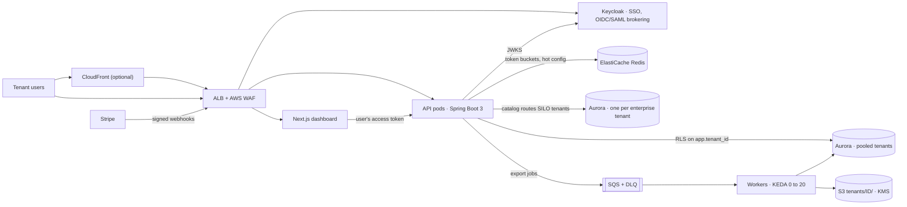

# Project 1 · TenantForge

**A multi-tenant B2B SaaS platform:** many customer organisations on one platform, each one's data isolated by the
database itself, a noisy tenant unable to slow the others, enterprise SSO, and billing driven by Stripe.

[](https://github.com/ARGOD2213/tenantforge/actions/workflows/ci.yml)

Spring Boot 3 (Java 21) · Next.js · PostgreSQL 16 / Aurora · Redis · SQS · S3 + KMS · Keycloak · Stripe ·
EKS · KEDA · Terraform · Argo CD · OpenTelemetry

---

## What it does, and where it's proven

Every row below is code in this repo plus a test that runs on every push.

| Guarantee | How | Proven by |
|---|---|---|
| **Tenants can't see each other's data, even if a query forgets a filter** | Postgres Row-Level Security: `ENABLE` + `FORCE`, one policy on `app.tenant_id`; the runtime role `tf_app` is not the owner and has `NOBYPASSRLS`; the tenant is bound on every connection checkout and cleared on return ([ADR 0001](docs/adr/0001-rls-tenant-isolation.md)) | `TenantIsolationIT` (7 tests), `ApiIT`, `scripts/demo.sh` |
| **Pool first, silo on demand** | Small tenants share the pooled database; enterprise tenants get their own, routed by a tenant catalog with the same code and schema ([ADR 0002](docs/adr/0002-pool-then-silo.md)) | `TenantIsolationIT.siloTenantRowsLiveInTheirOwnDatabase`, `MigrationsIT` |
| **One tenant can't flood the API for everyone** | Per-tenant token buckets in Redis (atomic Lua, Redis clock), sized by plan; over the limit → `429` + `Retry-After` | `RateLimitIT`, `ApiIT`, `scripts/demo.sh` |
| **Hot tenant config** | Catalog lookups cached in-process → Redis (`tf:{tenantId}:config`) → Postgres; evicted when billing changes the plan | `StripeWebhookIT.anUpgradeChangesThePlanLimitsAndEntitlements` |
| **Enterprise SSO** | Keycloak issues JWTs with `tenant_id` and `roles`; tenants can bring their own OIDC or SAML IdP, whose users are mapped into their tenant group | `KeycloakRealmIT` (4 tests, real Keycloak 26) |
| **Billing just works** | Stripe is the source of truth; signed webhooks (HMAC, replay window) are applied once, duplicates acknowledged and skipped ([ADR 0003](docs/adr/0003-stripe-source-of-truth.md)) | `StripeWebhookIT` (4), `StripeSignatureVerifierTest` (4) |
| **Slow work leaves the request path** | Exports go to SQS; workers (same image, `worker` profile) scale 0→20 on queue depth with KEDA; redrive to a DLQ with an alarm | `ExportWorkerIT` (LocalStack SQS + S3) |
| **Tenant files stay in their lane** | S3 keys under `tenants/{tenantId}/`, SSE-KMS with a dedicated key, IAM scoped to `tenants/*`, downloads by presigned URL | `ExportWorkerIT`, `scripts/demo.sh` |
| **Zero-downtime schema changes** | Expand/contract Flyway migrations run per database; indexes built `CONCURRENTLY` ([docs/migrations.md](docs/migrations.md)) | `MigrationsIT` |
| **See one tenant's traffic** | `tenant` tag on request metrics, tenant in every log line (MDC) and trace span; Grafana dashboard per tenant | `ApiIT.requestMetricsAreTaggedWithTheTenant` |

CI runs 34 tests against real Postgres, Redis, LocalStack and Keycloak containers, then boots the whole stack with
Docker Compose and runs [`scripts/demo.sh`](scripts/demo.sh) against it. It also builds the Next.js app, validates
the Kubernetes manifests (kubeconform) and the Terraform (`terraform validate`), and publishes images to GHCR.

## Architecture



**One request, end to end** (a tenant user opens their invoices):

1. The dashboard (Next.js, server-side) calls `GET /api/invoices` with the user's Keycloak access token.
2. Spring Security verifies the token against Keycloak's keys; `TenantResolutionFilter` reads exactly one
   `tenant_id`, checks the tenant is active in the catalog, and tags logs, traces and metrics with it.
3. `TenantRateLimitFilter` takes a token from that tenant's bucket in Redis, or answers `429` + `Retry-After`.
4. The repository runs `select … from app.invoices` with **no** tenant filter. The connection was routed to the
   pooled or silo database by the catalog and bound with `set_config('app.tenant_id', …)` on checkout; RLS returns
   only that tenant's rows.

## Run it locally

Needs Docker. Core mode needs about 1.2 GB of RAM, full mode about 2 GB.

```bash
# core: Postgres, Redis, LocalStack (SQS + S3), API, worker
docker compose -f deploy/docker-compose.yml up --build

# in another terminal: walks through every guarantee above against the running stack
scripts/demo.sh
```

Core mode uses development tokens from `POST /dev/token` (only in the `dev` profile), so Keycloak is optional:

```bash
TOKEN=$(curl -s -X POST "localhost:8081/dev/token?tenant=zenith" | jq -r .access_token)
curl -s localhost:8081/api/me -H "Authorization: Bearer $TOKEN" | jq
curl -s localhost:8081/api/invoices -H "Authorization: Bearer $TOKEN" | jq
curl -s -X POST localhost:8081/api/exports -H "Authorization: Bearer $TOKEN" | jq   # pro plan: allowed
```

Demo tenants: **acme** (free, pooled), **zenith** (pro, pooled), **orbit** (enterprise, silo database).

**Full mode** adds Keycloak and the dashboard:

```bash
docker compose -f deploy/docker-compose.yml --profile full up --build
# http://localhost:3000 · users alice (acme admin), bob (acme member), zara (zenith admin), omar (orbit admin) · password: demo
```

**Billing:** `scripts/send-test-webhook.sh <tenant-uuid> pro_monthly` sends a correctly signed subscription event.
With a Stripe account, `stripe listen --forward-to localhost:8081/webhooks/stripe` forwards real test events
(set `STRIPE_WEBHOOK_SECRET` to the secret it prints).

**Tests:** `cd api && mvn verify` (Testcontainers starts everything it needs).

## Deploy to AWS

Infrastructure is Terraform in [`infra/terraform`](infra/terraform); workloads are Kustomize in [`k8s`](k8s),
synced by Argo CD.

| Terraform creates | Notes |
|---|---|
| VPC across 3 AZs | public (ALB, NAT), private (EKS), isolated database and cache subnets; S3 gateway endpoint |
| EKS + managed nodes | access entries, IRSA for the API, worker, KEDA, External Secrets, OTel collector, LB controller |
| Aurora PostgreSQL 16 (Serverless v2) | pooled cluster with a reader; one more cluster per entry in `silo_tenants`; TLS forced, KMS, 14-day backups |
| ElastiCache Redis 7 | TLS in transit, AUTH token, KMS at rest, Multi-AZ failover |
| SQS export queue + DLQ | redrive after 5 receives, CloudWatch alarm when the DLQ is not empty |
| S3 tenant bucket + KMS key | public access blocked, TLS-only and KMS-only bucket policy, versioned |
| AWS WAF | managed common + bad-input rules, per-IP flood guard; attached to the ALB by the Ingress |
| Secrets Manager | one secret with generated DB, Redis, NextAuth and Keycloak credentials |
| CloudFront (optional) | caches `/_next/static/*` in front of the web app |

```bash
cd infra/terraform
cp backend.hcl.example backend.hcl && cp example.tfvars prod.tfvars   # edit both
terraform init -backend-config=backend.hcl
terraform apply -var-file=prod.tfvars
$(terraform output -raw configure_kubectl)
```

Then, once per cluster:

1. Helm-install the add-ons with the IRSA roles from `terraform output irsa_role_arns`: AWS Load Balancer
   Controller, KEDA (operator role), External Secrets Operator, Argo CD, and the OpenTelemetry Collector with
   [`deploy/observability/otel-collector-values.yaml`](deploy/observability/otel-collector-values.yaml).
2. `kubectl apply -f deploy/cluster/cluster-secret-store.yaml`
3. `infra/scripts/bootstrap-db.sh` creates the `tf_owner` / `tf_app` / `keycloak` roles and databases (run it again
   with a tenant slug for each silo cluster). The app runs its migrations on startup.
4. Fill the placeholders in `k8s/base` (account id, hosts, certificate) from `terraform output app_config`,
   `irsa_role_arns` and `waf_acl_arn`, then `kubectl apply -f argocd/application.yaml`. Argo CD syncs
   `k8s/overlays/prod` from `main`.
5. Import the realm into Keycloak without the demo users, point the clients at your hosts, and set
   `STRIPE_WEBHOOK_SECRET` in Secrets Manager to the signing secret of a Stripe endpoint for
   `https://api.<your-domain>/webhooks/stripe`.
6. Import [`deploy/observability/grafana-tenants-dashboard.json`](deploy/observability/grafana-tenants-dashboard.json)
   into Grafana (Prometheus data source).

> **Status:** the application, its tests and the local stack run in CI on every push. The AWS infrastructure is
> written and validated (`terraform validate`, kubeconform) but has not been applied to a live AWS account, so there
> is no public deployment.

## Repository layout

```
api/                     Spring Boot API and worker (one image, two profiles)
  src/main/java/…/tenancy    tenant catalog, tenant context
  src/main/java/…/db         RLS-aware datasource, pooled/silo routing, per-database migrations
  src/main/java/…/ratelimit  Redis token bucket (scripts/token_bucket.lua)
  src/main/java/…/security   JWT validation, tenant claims, dev tokens
  src/main/java/…/billing    Stripe signature check and idempotent webhook handling
  src/main/java/…/export     SQS queue, worker, CSV exports to S3
  src/main/resources/db      catalog/ and tenant/ Flyway migrations
web/                     Next.js dashboard (NextAuth + Keycloak)
deploy/                  docker-compose, Keycloak realm, LocalStack init, observability, cluster setup
k8s/                     Kustomize base + prod overlay (API, KEDA worker, web, Keycloak, Ingress, External Secrets)
argocd/                  Argo CD application
infra/terraform/         AWS infrastructure;  infra/scripts/ database bootstrap
scripts/                 demo.sh, send-test-webhook.sh
docs/                    ADRs and the migration playbook
```

---

Built by **Chintala Mahindra** · [portfolio](https://main-hub-mu.vercel.app)
